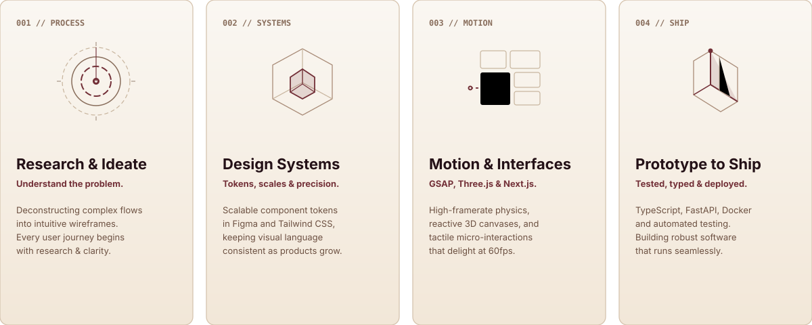
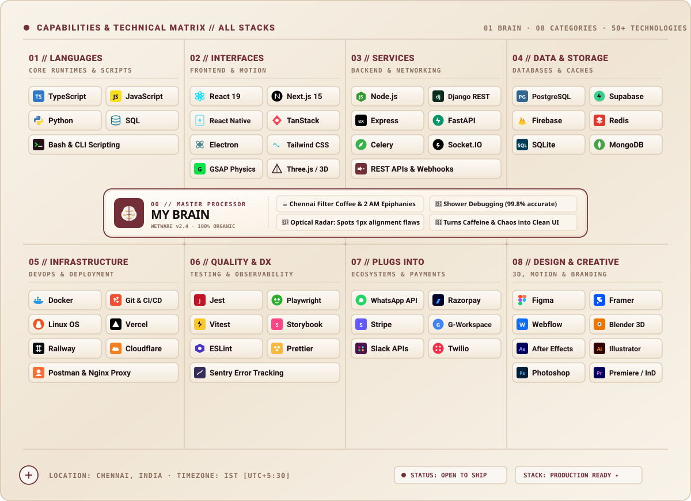

<div align="center">

<!-- ==================== HERO MASTHEAD ==================== -->


<br/><br/>

<!-- ==================== IMPACT METRICS STRIP ==================== -->


<br/><br/>

<!-- ==================== CORE PILLARS BENTO ==================== -->


<br/><br/>

<!-- ==================== PROJECT CHARTER ==================== -->


<br/><br/>

<!-- ==================== STACK MATRIX ==================== -->


<br/><br/>

</div>

---

### `01 // PHILOSOPHY`

> *"Software should feel like an instrument — immediate, tactile, and mathematically precise."*

I design and build at the boundary where **design systems**, **interaction physics**, and **strict frontend engineering** converge. Every interface is approached from first principles:
- **Zero layout shifts** and predictable kinetic motion.
- **Atomic tokens** connecting Figma directly to type-safe React & Next.js codebases.
- **Uncompromising accessibility (WCAG AAA)** without sacrificing editorial design fidelity.

---

### `02 // SELECTED FOCUS & CASE STUDIES`

| Index | Domain | Architecture & Technologies | Deliverable |
| :---: | :--- | :--- | :--- |
| **`001`** | **Design Systems & Token Pipelines** | Next.js 15, TypeScript, Tailwind CSS, Storybook | Multi-brand token architecture with automated Figma-to-code synchronization. |
| **`002`** | **Interactive 3D & Spatial UI** | Three.js, React Three Fiber, GLSL Shaders | Cursor-reactive WebGL surfaces, fluid distortion shaders, and 60fps animations. |
| **`003`** | **Navigation & State Architectures** | Concurrent React, Zustand, Route Middleware | Refactored multi-tenant portal layouts with zero-latency state transitions. |
| **`004`** | **Signal Processing & ML Interfaces** | Python, FastApi, Machine Learning, WebSockets | Visualizing high-frequency biological telemetry with real-time HUD analytics. |

---

### `03 // GET IN TOUCH`

```bash
$ curl -s https://api.github.com/users/pranov888/contact
```

<div align="center">

[](https://pranovdesign.vercel.app)
[](https://www.linkedin.com/in/pranov888)
[](mailto:pranov888@gmail.com)
[](https://github.com/pranov888)

<br/>

<sub>Crafted with custom SVG architecture · Inspired by Cosmic Latte, Mocha Cream &amp; Deep Burgundy</sub>

</div>

---

### `04 // CHANGELOG & UPDATE LOG`

- **2026-10-30 (`cosmic-burgundy-palette-2026-10-30`)**:
  - Replaced high-voltage green with the bespoke **Cosmic Latte (`#B7A89A`)**, **Mocha Cream (`#E8DCC6`)**, and **Deep Burgundy (`#722F37`)** luxury palette from Image 2.
  - Fully animated all shapes across all SVGs:
    - *Hero*: rotating turntables, live equalizer bars, and twinkling celestial stars (`✦`).
    - *Metrics*: animated pulse rings, floating star, and glowing Deep Burgundy card.
    - *Bento 001*: rotating concentric dashed rings, pulsing core, and sweeping radar scanner line.
    - *Bento 002*: levitating outer 3D isometric cube and rotating inner Deep Burgundy cube.
    - *Bento 003*: dynamic scanning bento box and flowing circuit dashed lines.
    - *Bento 004*: 3D oscillating prism with shimmer facet reflections.
    - *Charter*: signal pulse flow traveling across the bezier curve and double beacon rings.
    - *Matrix*: rotating plus anchor, pulsing star, and glowing pill border.
